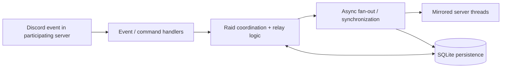

# GRAIDS — Cross-Guild Raid Coordination

**Selected production source + runnable, synthetic offline demonstration.**
The complete production Discord bot is **not** open-sourced in this repository.

GRAIDS is a Python system I developed to help coordinate WynnCraft raids across
independently administered Discord communities. Production functionality includes
mirrored raid discussions, party/lobby coordination, message relay, and persistent
mappings between original messages and their cross-server copies.

## Approximate production footprint

The figures below are developer-reported estimates as of September 2026;
**the public demo does not independently verify production usage**.

| Metric | Reported figure |
| --- | ---: |
| Participating Discord servers | 16 |
| Combined community membership (not unique active bot users) | 2,000+ |
| Originating messages processed daily | ~200 |
| Rough fan-out sizing estimate | ~3,200 = 200 × 16 endpoints; not a measured delivery count |
| Full production Python codebase | Approximately 10,000 lines |

With one of the 16 servers acting as the source, a message forwarded to all
*other* servers would make up to 15 cross-server copies. The ~3,200 figure
is a rough 16-endpoint sizing calculation, **not** evidence that 3,200
forwarded messages are actually delivered daily.

## What is available here

- **`src/graids_db/relay_message_copies.py`** — selected, unmodified
  production module that tracks original messages and their destination
  copies in a SQLAlchemy database. Handles multiple destination chunks,
  ordered retrieval, replacement, and deletion.
- **`src/graids_demo/formatting.py`** — two formatting helpers adapted from
  the real bridge, including edit formatting that avoids repeat live pings.
- **`src/graids_demo/offline_relay.py`** — newly written, **illustrative**
  transport that shows what mapping records are for. Uses fabricated IDs
  and keeps all simulated messages in memory; it does not contact Discord.
- **`tests/`** — synthetic tests covering mapping updates, deletion, chunking,
  and the offline demonstration.

The reduced `graids_db/engine.py` and `models.py` are demo scaffolding, **not
the original production database engine or full schema**. See
[source provenance and release boundaries](docs/SOURCE_BOUNDARY.md).

## Quick start (Python 3.11+)

Open this extracted directory as a project in PyCharm, then run in its
terminal:

```bash
python -m pip install -e ".[dev]"
python -m graids_demo
python -m pytest -q
```

No Discord account, bot token, network service, database file, or `.env`
configuration is needed for the demo. Dependencies are installed from your
normal Python package index.

For step-by-step IDE instructions, see [PyCharm setup](docs/PYCHARM_SETUP.md).

## Architecture and rationale



An originating message may produce several destination messages (for
example when content is chunked). Persistent source-to-copy mappings allow
later source edits or deletions to target the correct destination copies.
The public runnable example focuses only on this narrow data-lifecycle problem.

See [the architecture walkthrough](docs/ARCHITECTURE.md) for more context.

## Why the complete bot is private

The deployed system interacts with real communities and therefore includes
operational configuration, moderation/approval workflows, credentials,
webhook integrations, database state, logs, and user-related identifiers
that should not be published merely to make a portfolio repository larger.

The public repository intentionally excludes all production credentials,
IDs, logs, databases, live endpoints, old Git history, deployment archives,
and security-sensitive operational material.

## License / reuse

No open-source license is granted by default. The code is published here as
portfolio source for inspection. If I later want to permit redistribution
or reuse, I will add an explicit license.

WynnCraft and Discord are third-party services. This project is independently
developed and is not an official product of either.
