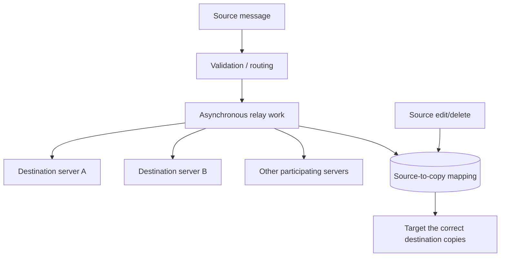

# Architecture walkthrough

## Production context (high level)

GRAIDS coordinates raid activity across independently managed Discord servers.
At a high level, events enter through Discord-facing handlers, pass through
lobby/relay logic, fan out asynchronously, and store enough state in SQLite to
keep mirrored objects consistent.

The full implementation addresses more concerns than this diagram shows, but
those details are outside the public release boundary.

## The part demonstrated publicly

A source Discord message can create more than one destination message when it
is split into chunks. For each destination copy, the production mapping table
records:

- relay surface;
- source guild, channel and message IDs;
- destination guild, channel and message IDs;
- stable chunk index;
- creation timestamp.

This lets the application retrieve the ordered set of destination copies for
a source message. Replacing a mapping after fan-out/edit is transactional, and
deleting a source mapping removes all known destination associations.

The local `graids_demo` module creates fabricated message IDs and a temporary
in-memory database to make that lifecycle inspectable without Discord access.

## What this does *not* disclose

The public demo is not intended to document production authentication,
permissions, moderation policy, real channel topology, webhook endpoints,
deployment settings, or anti-abuse operations.
